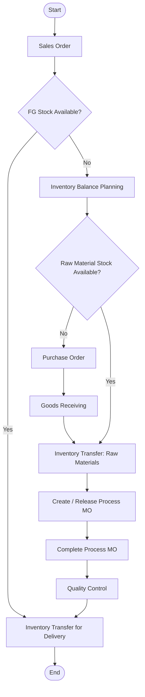

# Manufacturing & Production Workflow

This workflow connects sales order fulfillment with inventory, procurement, manufacturing, and quality control.

## Process

1. **Sales order:** Record the customer's order.
2. **Check finished-goods (FG) stock:**
   - If the ordered goods are available, transfer the inventory for delivery and complete the order.
   - If stock is unavailable, start inventory balance planning.
3. **Check raw-material (RM) stock:**
   - If raw materials are available, transfer them to production.
   - If raw materials are unavailable, create a purchase order, receive the goods, and transfer the received materials to production.
4. **Create and release the manufacturing order (MO):** Schedule and release work to the production floor.
5. **Complete the manufacturing order:** Record production completion.
6. **Quality control (QC):** Inspect the finished goods.
7. **Transfer approved finished goods:** Move QC-approved goods to the inventory location used to fulfill the sales order.

## Flow

## Operational notes

- Track sales-order quantities against available finished-goods inventory.
- Link raw-material requirements and purchase orders to the manufacturing order.
- Record receipt, inventory transfers, production completion, and QC decisions for traceability.
- Only QC-approved finished goods should be transferred for sales-order fulfillment.
